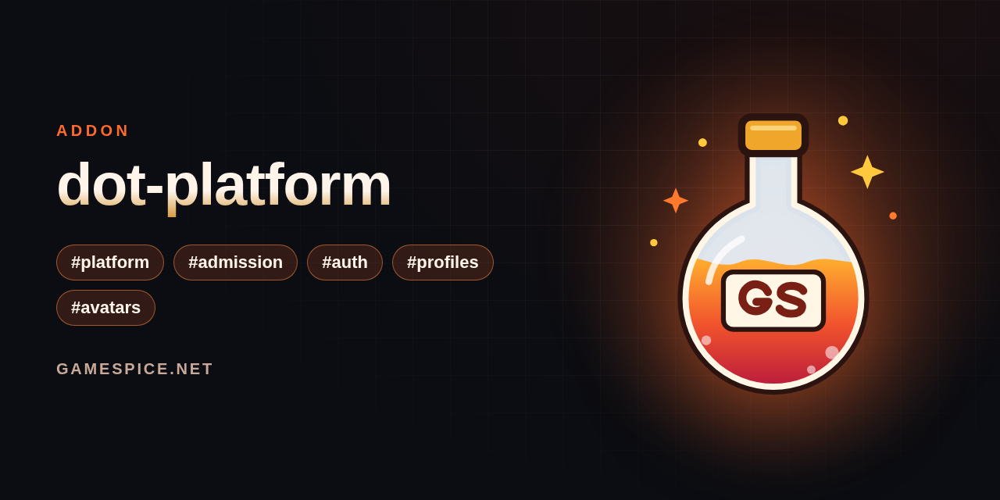

[](https://moddingcommunity.com/a/17-gs-platform)

Joins the GameSpice identity addons into one signed-in player: who they are (GameSpice Auth), what we know about them (GameSpice User) and what they look like (GameSpice User Avatar). Each of those addons works alone; this one connects them.

Requires [GameSpice Core](https://github.com/gamespice-platform/core) and [GameSpice Server](https://github.com/gamespice-platform/server). It finds GameSpice Auth, GameSpice User and GameSpice User Avatar at runtime and works with any subset, including none.

## Install

1. Copy `addons/gs_platform/` and `addons/gs_core/` into your project, plus whichever of GameSpice Auth, GameSpice User and GameSpice User Avatar you want.
2. Enable them in *Project > Project Settings > Plugins*.

## Use

```gdscript
var hub := GSPlatformHub.new()
add_child(hub)

var admitted := await hub.admit(identity)      # identity from gs-auth
var player: GSPlatformPlayer = admitted.value

player.key()            # scoped id, what everything else uses
player.display_name()   # from the profile, falling back to the identity
player.avatar           # resolved and entitlement-checked
```

On a GameSpice Server, load the module and it does this for every connection:

```gdscript
server.modules.load_module("res://addons/gs_platform/gs_platform_module.gd")
```

It finds the hub through `GSRegistry`, admits each authenticated client, stores the result in `session.data["platform"]`, applies the profile's name, and cleans up when the client leaves. It adds the console commands `platform_status` and `platform_name`.

When the server has a site integration credential, a signed-in member's avatar and profile are read from and kept on the site, so they follow the member to every server using that credential. Guests and local accounts keep their profile on the server's disk.

## Why a scoped key

```
identity.uid          "backbone:acc-1"     global; a server must never see this
   -> profile.user_key  "sWrM4ym4beWFH0Nx"  scoped; what everything else keys on
   -> avatar filed under the SAME scoped key
```

Keying data on the global account id would hand every server operator a global identifier for every player. `GSPlatformHub` is the only place that translation happens.

## What happens when addons are missing

| Installed | Result |
| --- | --- |
| all three | profile, avatar, entitlements, onboarding flag |
| GameSpice User only | a profile and a scoped key, no avatar |
| none | a player with the identity's name and no scoped key |
| a broken store | the player still joins, nothing is saved |

## Examples

Both exit non-zero on failure.

| Command | What it does |
| --- | --- |
| `godot --headless --path . res://examples/seam_selftest.tscn` | All four addons in one process with real keys, ticket and stores. |
| `godot --headless --path . res://examples/sandbox_server.tscn` | A real server and client over loopback, through the whole sign-on. |

More: [docs/design.md](docs/design.md), [docs/history.md](docs/history.md).

## Used by

Every game in the collection vendors it, and each admits its players through `GSPlatformHub`:

- [Fatal Contact](https://zeesgames.com/fatal-contact)
- [Airdrift](https://zeesgames.com/airdrift)
- [Playlot](https://zeesgames.com/playlot)
- [Hungario](https://zeesgames.com/hungario)
- [Buses From Hell](https://zeesgames.com/buses-from-hell)
- [Smash Copter](https://zeesgames.com/smash-copter)
- [Zombie Zone](https://zeesgames.com/zombie-zone)
- [Hide n Seek](https://zeesgames.com/hide-n-seek)
- [Prop Hunt](https://zeesgames.com/prop-hunt)
- [Murder Mystery](https://zeesgames.com/murder-mystery)
- [Deathrun](https://zeesgames.com/deathrun)
- [Wipeout](https://zeesgames.com/wipeout)
- [Dangerous Delivery](https://zeesgames.com/dangerous-delivery)
- [Look At Me](https://zeesgames.com/look-at-me)

The whole collection is at [zeesgames.com](https://zeesgames.com).

## Status and licence

Part of the [**GameSpice**](https://gamespice.net) platform: a family of Godot addons, MIT licensed and built with Claude Code. Run `seam_selftest` and `sandbox_server` (see Examples) to check it headlessly. Every game in [Zee's Games](https://zeesgames.com) signs players in through it, and those games run on live servers. Problems go to the [issue tracker](https://github.com/gamespice-platform/platform/issues).

MIT licence, see [LICENSE](LICENSE). The only closed part of the [**GameSpice**](https://gamespice.net) platform is the web back end; you can use your own instead of GameSpice's.
